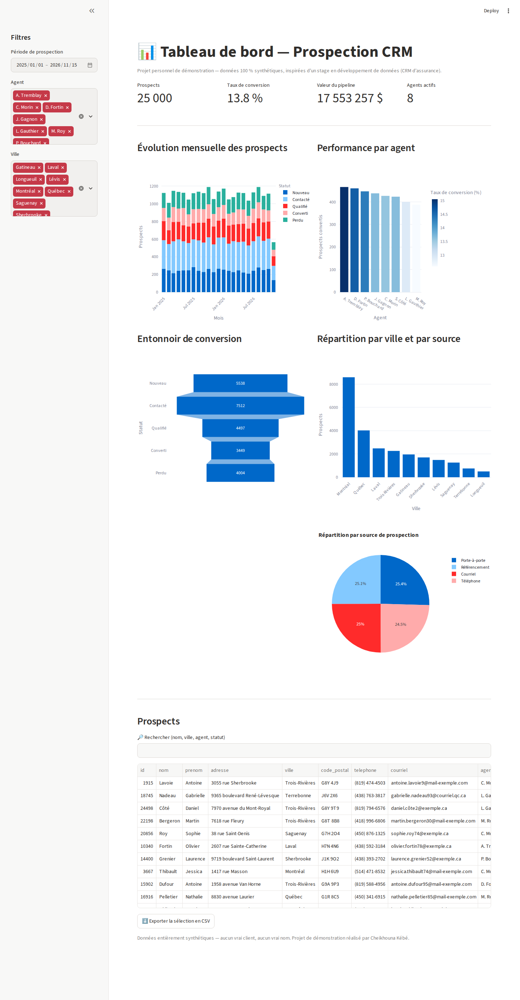
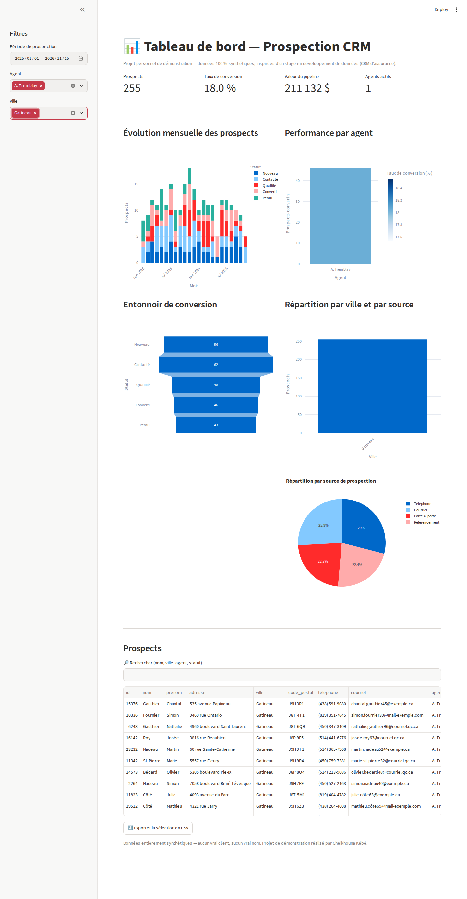
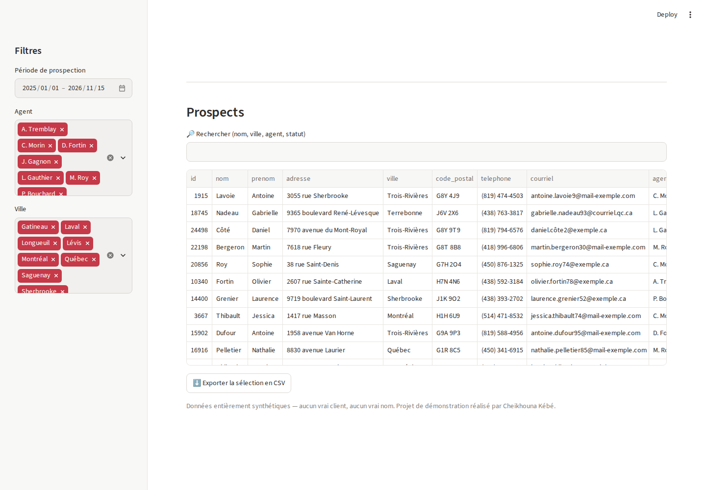

# Tableau de bord — Prospection CRM

> ⚠️ **Données 100 % synthétiques.** Tous les noms, adresses, téléphones et
> courriels de ce projet sont inventés. Aucune vraie donnée d'entreprise n'est
> utilisée : c'est un projet personnel de démonstration, inspiré d'un stage en
> développement de données (CRM d'assurance).

## Contexte

Ce projet reproduit, à petite échelle, le travail réalisé lors d'un stage de
développement logiciel *Data et Backend* (mai–août 2026) : automatiser le
transfert des exports CSV d'un CRM externe vers une base de données, puis
exploiter ces données dans un tableau de bord.

- **ETL** : lecture d'un export CSV brut, nettoyage (doublons, valeurs
  manquantes, normalisation des villes et des téléphones), chargement en base
  SQLite.
- **Dashboard** : application Streamlit interactive — filtres, KPI, graphiques
  et export CSV.

## Captures d'écran



*Vue d'ensemble : KPI, évolution mensuelle, performance par agent, entonnoir
de conversion et répartition par ville et par source.*



*Vue filtrée : même tableau de bord restreint à un agent et une ville, avec la
table des prospects et l'export CSV.*



*Table consultable (recherche par nom, ville, agent ou statut) et bouton
d'export de la sélection en CSV.*

## Données

`generate_data.py` crée **25 000 prospects fictifs** (janvier 2025 à
novembre 2026) : nom, adresse, ville (Montréal, Québec, Trois-Rivières,
Laval, Gatineau, Sherbrooke, Lévis, Saguenay…), agent (8 agents), date de
prospection, source (téléphone, courriel, porte-à-porte, référencement),
statut (nouveau, contacté, qualifié, converti, perdu) et montant potentiel.

Le volume (25 000 lignes) se situe dans la fourchette réelle traitée en
stage (10 000 à 60 000 lignes d'exports CRM).

## Installation et lancement

```bash
# 1. Cloner le dépôt puis installer les dépendances
pip install -r requirements.txt

# 2. Générer les données synthétiques
python generate_data.py

# 3. Exécuter l'ETL (CSV brut -> SQLite)
python etl.py

# 4. Lancer le tableau de bord
streamlit run app.py
```

L'application s'ouvre ensuite sur http://localhost:8501.

## Structure du projet

```
dashboard-prospection/
├── generate_data.py   # Génération des données synthétiques (25 000 lignes)
├── etl.py             # Pipeline ETL : nettoyage + chargement SQLite
├── app.py             # Application Streamlit (tableau de bord)
├── requirements.txt   # Dépendances Python
├── data/
│   ├── prospects_brut.csv   # Export CSV brut (généré)
│   └── prospects.db         # Base SQLite (générée par etl.py)
├── screenshots/       # Captures d'écran du dashboard
└── README.md
```

## Stack

- **Python** — génération des données et ETL
- **Pandas** — nettoyage et transformation
- **SQLite** — stockage des données nettoyées
- **Streamlit** — application web du tableau de bord
- **Plotly** — graphiques interactifs

## Auteur

Cheikhouna Kébé — Diplômé en informatique, cheminement science des données
(UQTR, octobre 2026). Stage : développeur logiciel Data et Backend, Sphère
Contact inc., Trois-Rivières (mai–août 2026).

---

## English summary

Personal demo project: a synthetic CRM prospection dataset (25,000 rows),
a Pandas ETL pipeline (CSV → SQLite) and an interactive Streamlit dashboard
(KPIs, Plotly charts, filters, CSV export). **All data is synthetic** — no
real customer data. Built to showcase data engineering and BI skills
(Python, Pandas, SQL, Streamlit, Plotly, Power BI mindset).
